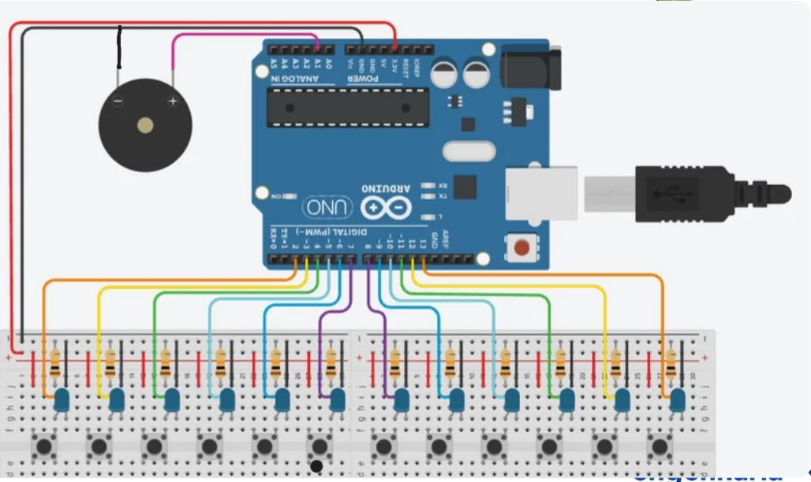

# Piano Interativo: guia de montagem

O projeto tem duas partes:

- **O piano físico:** 12 botões (uma oitava, de Dó a Si), um LED em cada botão e um buzzer que toca as notas.
- **O app:** a página `web/index.html`. Ela mostra o teclado na tela, ensina melodias e tem um jogo da memória.

## Peças

| Quantidade | Peça |
|---|---|
| 1 | Arduino Uno + cabo USB (A-B) |
| 1 ou 2 | Protoboard (uma grande de 830 furos ou duas menores) |
| 12 | Botões (push button 12×12 mm) |
| 12 | LEDs |
| 12 | Resistores de 10 kΩ: 4 faixas marrom, preto, laranja, ou 5 faixas marrom, preto, preto, vermelho |
| 12 | Resistores de 220 Ω: 4 faixas vermelho, vermelho, marrom, ou 5 faixas vermelho, vermelho, preto, preto |

> Leia as cores a partir da ponta onde as faixas estão mais juntas; a última faixa, mais afastada, é a precisão e não conta. Sem esses valores exatos: para o botão serve de 4,7 kΩ a 47 kΩ; para o LED, de 220 Ω a 1 kΩ.
| 1 | Buzzer passivo |
| ~30 | Jumpers (fios) macho-macho |

## Ligações

**Antes de tudo:** todos os fios ficam na **parte de cima** da protoboard, para não atrapalhar os dedos na hora de tocar. Usamos só os dois trilhos de cima: a linha vermelha (+), na borda, e a linha azul (−), logo abaixo dela. Os trilhos de baixo ficam vazios.

**Trilhos divididos:** em muitas protoboards grandes, a linha vermelha e a azul têm uma falha no meio. Isso quer dizer que cada metade é um trilho separado. Se a sua for assim, ligue os dois lados de cada linha que você usar com um fio curto.

**Alimentação:** ligue o **5V** do Arduino na **linha vermelha (+)** de cima (fio vermelho) e um **GND** na **linha azul (−)** de cima (fio preto).

**Buzzer:** ligue o **+** do buzzer no pino **A1** e o **−** **direto no outro pino GND** do Arduino. O buzzer vai no A1, e não no +, porque é o Arduino que faz ele vibrar na frequência de cada nota.

**Cada tecla** (o botão atravessa o canal do meio; usamos só as **duas pernas de cima**):

1. Perna de cima à direita → fio vermelho curto até o trilho **+** de cima.
2. Coluna da perna de cima à esquerda:
   - resistor de **10 kΩ** até o trilho **−** de cima (mantém o pino em 0 V quando ninguém aperta);
   - fio até o pino do Arduino daquela nota (tabela abaixo);
   - perna **longa** do LED.
3. Perna curta do LED na coluna ao lado → resistor de **220 Ω** até o trilho **−** de cima.

> Por dentro, o botão tem pares de pernas sempre ligadas. Se a nota tocar sem parar, o botão está girado do jeito errado: gire-o 90° e encaixe de novo.

Quando o botão é apertado, o pino recebe 5V (HIGH), o LED acende e o Arduino toca a nota.

> A imagem acima é a montagem original do grupo, com um resistor por tecla. A versão com dois resistores (10 kΩ + 220 Ω) evita notas tocando sozinhas, e é a que a apresentação "Vamos montar um piano!" ensina.

| Pino | 2 | 3 | 4 | 5 | 6 | 7 | 8 | 9 | 10 | 11 | 12 | 13 |
|---|---|---|---|---|---|---|---|---|---|---|---|---|
| Nota | Dó | Dó♯ | Ré | Ré♯ | Mi | Fá | Fá♯ | Sol | Sol♯ | Lá | Lá♯ | Si |

> Não use os pinos 0 e 1: eles são a comunicação USB com o computador.

## Enviar o código para o Arduino

1. Instale a [Arduino IDE](https://www.arduino.cc/en/software).
2. Abra `Codigo_Piano/Codigo_Piano.ino`.
3. Em **Ferramentas → Placa**, escolha **Arduino Uno**. Em **Ferramentas → Porta**, escolha a porta do Arduino.
4. Clique em **Carregar** (a seta →).
5. **Feche a Arduino IDE** antes de abrir o app. A IDE ocupa a porta USB e o app não consegue conectar.

## Testar

> **Testando antes de montar as 12 teclas?** Ligue um fio do **pino 13** até o trilho **−**. Sem nada ligado, o pino 13 (o da luz "L" da placa) parece apertado e o buzzer toca o Si sem parar. Tire esse fio quando montar a tecla Si.

1. Abra `web/index.html` no Google Chrome ou no Microsoft Edge (veja `web/COMO_USAR.md`).
2. Clique em **🔌 Conectar piano** e escolha a porta do Arduino.
3. Aperte cada botão. Ele deve tocar a nota no buzzer e acender a tecla certa na tela.
4. No **Jogo da memória**, o buzzer toca a sequência que o app mostra.

## Problemas comuns

| O que acontece | O que fazer |
|---|---|
| Metade das teclas não funciona, ou toca sozinha | Os trilhos da protoboard são divididos no meio: ligue os dois lados de cada linha (+ e −) com um fio. |
| Uma nota toca sem parar | Gire o botão daquela tecla 90° (as pernas de cima estão sempre ligadas nessa posição). |
| O app não conecta | Feche a Arduino IDE e qualquer outro programa usando o cabo, e tente de novo. |
| A tecla errada acende na tela | Confira se o fio do botão está no pino certo (tabela acima). |
| Notas tocam sozinhas, sem ninguém apertar | Um pino está "solto": confira o resistor daquele botão e se o fio está bem encaixado. |
| O buzzer apita sem parar | Falta o fio do pino 13 no trilho − (veja "Testar"), ou a perna − do buzzer não está no GND. Para descobrir qual pino "está apertado", abra o Monitor Serial da IDE (9600) e aperte RESET: o número que aparecer sozinho é a tecla (pino = número + 1). |
| O LED pisca sozinho | O código do piano ainda não foi carregado: a placa está rodando o exemplo "Blink" de fábrica. |
| Nenhum som | Confira o buzzer no A1 e no GND. Use um buzzer **passivo** (o ativo só faz um bip). |
